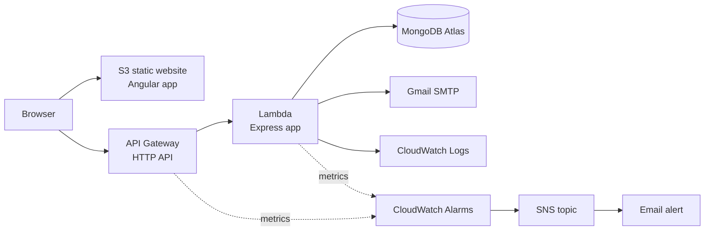

# DiscoverIndia

A tourism website for exploring destinations across India. Visitors can browse and search destinations by state, set their travel preferences, and create an account. The frontend is hosted on Amazon S3 and the backend runs serverless on AWS Lambda, with the infrastructure defined in Terraform.

## Features

- Browse and search destinations by state, with a detail page for each place
- Travel preference form and preference-based recommendations
- Sign up and log in with JWT authentication and reCAPTCHA
- Contact and enquiry form that sends email through Gmail SMTP
- Monitoring: CloudWatch alarms send email alerts (through SNS) for Lambda errors, throttling, slow responses and API 5xx errors

## Architecture



| Layer | Technology |
|---|---|
| Frontend | Angular 17, SCSS |
| Backend | Node.js, Express, Mongoose, `@vendia/serverless-express` |
| Database | MongoDB Atlas |
| Hosting | S3 (frontend), Lambda + API Gateway HTTP API (backend) |
| Infrastructure as code | Terraform (remote state in S3) |
| Monitoring | CloudWatch Logs and Alarms, SNS email alerts |
| CI | GitHub Actions (backend tests, frontend build) |
| Tests | Mocha and Chai (backend), Karma (frontend), Selenium with TestNG (UI) |

## Project structure

```
backend/      Express API (also runs on Lambda through handler.js)
frontend/     Angular application
infra/
  bootstrap/  Terraform: S3 bucket that stores Terraform state
  main/       Terraform: Lambda, API Gateway, IAM role, CloudWatch log group,
              monitoring.tf (CloudWatch alarms + SNS email alerts)
ml_service/   Python recommendation service (not deployed yet, see Roadmap)
travel-tests/ Selenium UI tests (Java, TestNG)
.github/      GitHub Actions workflows
```

## Run locally

**Backend**

```bash
cd backend
npm install
```

Create `backend/.env` (never commit it):

```
DB_URI=<your MongoDB connection string>
JWT_SECRET=<long random string>
RECAPTCHA_SECRET_KEY=<reCAPTCHA v2 secret key>
GMAIL_USER=<gmail address used to send email>
GMAIL_PASS=<Gmail app password>
FRONTEND_URL=http://localhost:4200
```

```bash
npm start        # http://localhost:5000
```

**Frontend**

```bash
cd frontend
npm install --legacy-peer-deps
npm start        # http://localhost:4200
```

Set `apiUrlNode` in `frontend/src/environments/environment.ts` to `http://localhost:5000`, and `recaptchaSiteKey` to your reCAPTCHA site key.

## Tests

```bash
cd backend && npm test          # Mocha/Chai
cd frontend && npm test         # Karma
```

The backend tests create and delete users in the database named by `DB_URI`. Point `DB_URI` at a throwaway test database, never at production data. The Selenium UI tests are in `travel-tests/`.

## API

| Method | Path | Notes |
|---|---|---|
| GET | `/api/destinations` | All destinations |
| GET | `/api/destinations/byState/:stateId` | Destinations in a state |
| GET | `/api/destinations/search` | Search destinations |
| GET | `/api/destinations/:name` | One destination |
| POST | `/api/recommendations` | Recommendations from filters (travel type, budget, season, activities) |
| GET | `/api/recommendations/experience/:experience` | Recommendations by experience |
| POST | `/signup` | Create account (reCAPTCHA required) |
| POST | `/login` | Returns a JWT |
| POST | `/forgot-password` | Emails a reset link |
| POST | `/reset-password` | Sets a new password with a valid reset token |
| POST | `/enquiry` | Sends the contact form by email |
| POST | `/api/preferences` | Save preferences (login required) |
| GET | `/api/preferences/:userId` | Read your latest preferences (login required) |
| POST | `/api/chatbot/chatbot-recommend` | Needs the ML service |

## Deploy to AWS

Prerequisites: an AWS account, the AWS CLI configured (`aws configure`), Terraform 1.10 or newer, and Node.js 20.

### 1. Create the Terraform state bucket (once)

```bash
cd infra/bootstrap
terraform init
terraform apply
```

This prints the bucket name as `state_bucket`.

### 2. Deploy the backend (Lambda + API Gateway + monitoring)

Copy `infra/main/terraform.tfvars.example` to `infra/main/terraform.tfvars` and fill in the values, including `alert_email`, the address that receives alarm emails. This file holds secrets and is gitignored; never commit it.

Build a clean copy of the backend (no `.env`, no tests, production dependencies only):

```powershell
powershell -ExecutionPolicy Bypass -File infra\main\build.ps1
```

Then:

```powershell
cd infra\main
terraform init "-backend-config=bucket=<state_bucket from step 1>"
terraform plan
terraform apply
```

The output `api_url` is the backend address. Check it:

```bash
curl -i "<api_url>/api/destinations"
```

After the first apply, AWS sends a confirmation email to `alert_email`. Open it and click **Confirm subscription**, otherwise no alerts are delivered.

### 3. Deploy the frontend (S3)

Set `apiUrlNode` in `frontend/src/environments/environment.ts` to the `api_url`, then:

```bash
cd frontend
npm install --legacy-peer-deps
npm run build
aws s3 sync dist/project/browser s3://<your-bucket> --delete
```

The bucket needs static website hosting enabled, with `index.html` as both the index and error document so that Angular routes work on refresh.

## Monitoring and alerts

`infra/main/monitoring.tf` creates an SNS topic with an email subscription and these CloudWatch alarms:

| Alarm | Triggers when |
|---|---|
| `discoverindia-lambda-errors` | Lambda reports 1 or more errors in 5 minutes |
| `discoverindia-lambda-throttles` | Lambda invocations are throttled |
| `discoverindia-lambda-slow` | Average Lambda duration stays above 5 seconds for 10 minutes |
| `discoverindia-api-5xx` | API Gateway returns 1 or more 5xx responses in 5 minutes |

The error and 5xx alarms also email you when they return to normal.

Test the email path without causing a real failure:

```bash
aws cloudwatch set-alarm-state \
  --alarm-name discoverindia-lambda-errors \
  --state-value ALARM \
  --state-reason "test"
```

Application logs are in CloudWatch Logs under the Lambda function's log group.

## Cost and teardown

Everything defined in `infra/main` is pay-per-request, so it costs close to nothing when idle. API Gateway is throttled to 10 requests per second (bursts of 20) to cap abuse and cost. There is no NAT gateway, load balancer or database server in the stack. The alarms and SNS email notifications add a negligible cost at this scale.

To remove the backend and its alarms:

```bash
cd infra/main
terraform destroy
```

The state bucket is protected from deletion on purpose.

## Security

- Secrets are never stored in the repository: they live in a gitignored `terraform.tfvars` and in the Lambda environment
- Passwords are hashed with bcrypt (`bcryptjs`)
- Password reset links are signed with a purpose claim and the current password hash, so they work only once and cannot be used as login tokens
- Rate limiting on login, signup and password reset routes
- CORS restricted to the frontend origin
- Preferences routes require a valid login token and use the user ID from the token
- Passwords, tokens and database addresses are not logged
- Internal error messages are hidden from clients in production


## Author

Neha Amina Riyaz
